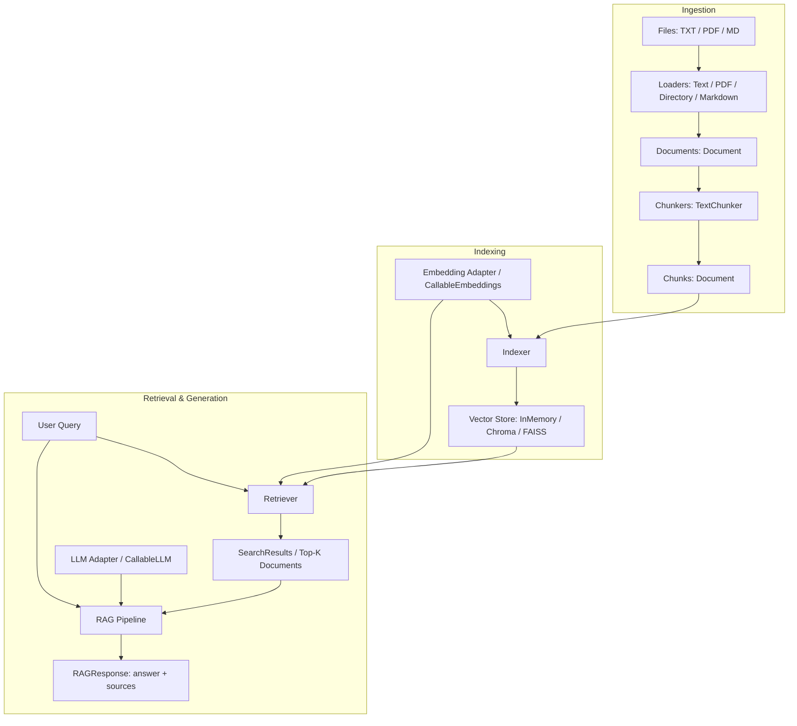

# `gen-ai` Architecture Overview

## 1. Vision & Core Philosophy

`gen-ai` is an independent, lightweight, and extensible Python Retrieval-Augmented Generation (RAG) framework.

**Philosophy:** *Users bring their own AI models (LLMs, Embeddings) and storage. The framework provides the complete RAG infrastructure.*

The framework intentionally does NOT implement:
- Proprietary LLM weights or inference runtimes
- Custom embedding model weights
- Tokenizer binaries or deep learning model training

Instead, it orchestrates:
1. Document ingestion (TXT, PDF, Markdown, Directory)
2. Document processing and text chunking
3. Embedding orchestration through adapters
4. Vector database indexing (In-Memory, ChromaDB, FAISS)
5. Similarity search & retrieval
6. Context construction & prompt templating
7. RAG orchestration with source citations
8. Configuration, validation, and error management

---

## 2. Component Architecture

---

## 3. Layer Separation & Interfaces

### Core (`gen_ai.core`)
- `Document`: Fundamental document entity with `id`, `content`, `metadata`.
- `SearchResult`: Retrieved document with `score` (similarity or distance) and `metadata`.
- `RAGConfig`: Validated configuration for chunking, retrieval, prompts.
- `exceptions`: Comprehensive error hierarchy rooted at `GenAIError`, including `DependencyError` with user-friendly installation instructions.

### Interfaces (`gen_ai.interfaces`)
- `BaseEmbeddings`: Contract for generating document and query vectors (`embed_documents`, `embed_query`).
- `BaseLLM`: Contract for text generation (`generate`).
- `BaseVectorStore`: Contract for storage, retrieval, and deletion (`add_documents`, `search`, `search_with_scores`, `delete`).
- `BaseLoader`: Contract for converting sources into `Document` objects (`load`).
- `BaseChunker`: Contract for splitting `Document` objects (`split_documents`).

### Adapters (`gen_ai.adapters`)
- `CallableEmbeddings`: Wraps user-supplied Python functions `embed_documents` and `embed_query`.
- `CallableLLM`: Wraps user-supplied Python function `generate`.
- Provider Adapters (OpenAI, Gemini, Groq, Ollama, Sentence Transformers) with lazy importing and dependency guarding.

### Ingestion (`gen_ai.ingestion`)
- Loaders: `TextLoader`, `PDFLoader`, `DirectoryLoader`, `MarkdownLoader`.
- Chunkers: `TextChunker` (character-based sliding window with automatic overlap).

### Storage (`gen_ai.vectorstores`)
- `InMemoryVectorStore`: Zero-dependency, pure Python cosine similarity vector store.
- `ChromaVectorStore`: ChromaDB integration for persistent vector storage.
- `FAISSVectorStore`: FAISS integration with explicit document-ID-to-index mapping.

### Indexing & Retrieval (`gen_ai.indexing`, `gen_ai.retrieval`)
- `Indexer`: Orchestrates chunking, batch embedding, and vector insertion.
- `Retriever`: Embeds queries and queries vector stores with optional threshold filtering.

### Pipeline & Public API (`gen_ai.pipelines`, `gen_ai.rag`)
- `RAGPipeline`: End-to-end prompt construction, context building, and answer generation.
- `RAG`: Simple, intuitive public API (`from gen_ai import RAG`).
